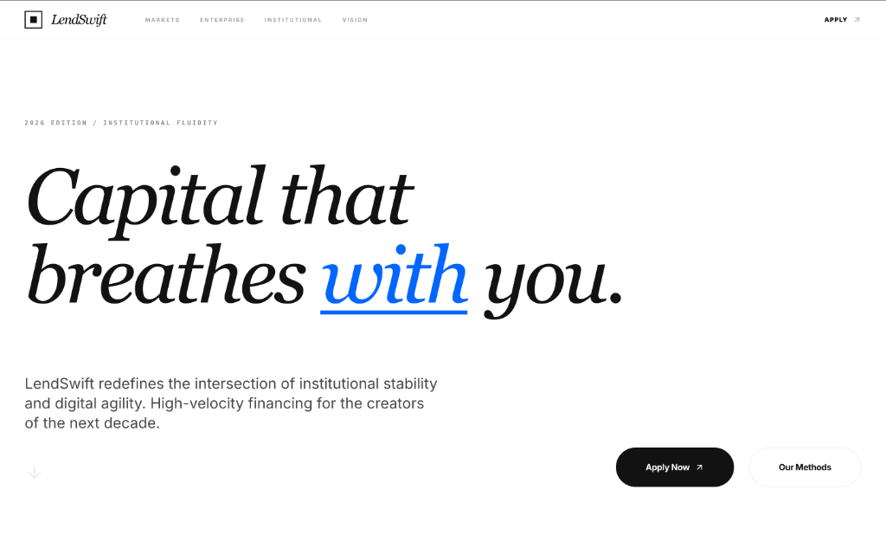

# LendSwift

LendSwift is a loan application website I built to practice building a really long, multi-step form properly. You choose a loan, play with the amount and tenure sliders and watch the EMI change, and then work through 8 steps (personal details, KYC, address, job, co-applicant, documents, review) until you submit. Your progress is saved as you go, so you can close the tab and carry on later.

I picked this idea because long forms are usually painful. I wanted to see if I could make one that feels nice to use, checks your input properly, and doesn't fall apart when you hit refresh or poke around in the URL.



[](https://vitejs.dev/)
[](https://reactjs.org/)
[](https://tailwindcss.com/)
[](https://github.com/pmndrs/zustand)
[](https://www.cypress.io/)

**Important:** this is a front-end only project. The OTP, PAN and Aadhaar checks, face match, location check, document scanning, bank lookup and even the final "submit" are all fake. They are just timers and sample data. Nothing goes to a server, and no real KYC or credit check happens. Please don't type in your real details.

## Contents

- [What you can do in it](#what-you-can-do-in-it)
- [The 8 steps](#the-8-steps)
- [Loan limits](#loan-limits)
- [What gets validated](#what-gets-validated)
- [Run it on your machine](#run-it-on-your-machine)
- [Data to use when trying it out](#data-to-use-when-trying-it-out)
- [Built with](#built-with)
- [How it works inside](#how-it-works-inside)
- [Folder layout](#folder-layout)
- [Scripts](#scripts)
- [Tests](#tests)
- [What I want to add next](#what-i-want-to-add-next)
- [License](#license)

## What you can do in it

- Play with the loan amount and tenure and see the EMI, total interest and total repayment update straight away.
- Go through the application one step at a time. Every step has its own URL (`/apply/step/1` up to `/apply/step/8`), so refreshing the page or using the browser's back button works the way you'd expect.
- Try to cheat by typing `/apply/step/8` into the address bar. It won't let you. If step 1 isn't finished you get sent back to it.
- Close the tab halfway and come back. Everything is saved in your browser's local storage, and a "Resume Application" popup asks if you want to continue or start over.
- Get a co-applicant step only when the loan actually needs one (the rules are in the [loan limits](#loan-limits) section).
- Upload documents by dragging them in or clicking. Big images are compressed in the browser first, and each file goes through a fake scanning step.
- Draw your signature on a canvas and accept the loan agreement.
- Look over a summary of everything on the review page, tick the declaration and submit. You then get an application ID, a tracking timeline and a text summary you can download.
- Use it on a phone. I checked the layout from small phone width up to a regular desktop screen.

A few smaller things I added along the way:

- Screen readers are told when you move to a new step.
- The resume popup closes with the Escape key.
- Pressing Enter in a text field takes you to the next step if everything is filled in.
- If the saved data in your browser looks broken, the app says so and lets you reset instead of crashing.
- If you change the application in another tab, you get a warning to reload so the two don't overwrite each other.

## The 8 steps

**1. Loan Selection.** Choose Personal, Home or Business, set the amount and tenure with the sliders, then pick a purpose, your employment type and your monthly income. The EMI panel on the side updates live.

**2. Personal Info.** Name, date of birth, gender, marital status, mobile number (with a fake OTP), email, PAN, Aadhaar, occupation, education and annual income. PAN and Aadhaar each have their own verify button.

**3. KYC Verification.** Verify PAN and Aadhaar again, pick a second ID (like a passport) and enter its number, upload the PAN, Aadhaar and second ID, then do a fake selfie and face match.

**4. Address.** Your current address, with a PIN code lookup that fills in the city and state. Then residence type, how long you've lived there, an optional previous address and a permanent address (or "same as current"). You also click a fake location check and upload an address proof.

**5. Employment.** Choose Salaried, Self-employed, Business, Freelancer or Retired, and the form changes to match what that kind of person would need to fill in. After that comes the bank details (IFSC lookup, account type) and your monthly obligations.

**6. Co-Applicant.** Relationship, identity details, mobile, PAN and Aadhaar checks, income and EMIs, a signature and consent. A side panel shows combined income, the joint debt-to-income ratio and an approval confidence score. This step is skipped, optional or mandatory depending on the loan.

**7. Documents.** Upload whatever is still missing, which is always bank statements plus extras like income proof, GST certificate, ITR or property papers depending on the loan. Then switch to the e-signature tab to sign and accept the agreement.

**8. Review.** A summary of every section with shortcuts to go back and edit, a final declaration checkbox and the submit button. A fake submission progress screen runs and then you land on the success view.

## Loan limits

|                            | Personal                               | Home             | Business            |
| -------------------------- | -------------------------------------- | ---------------- | ------------------- |
| Amount                     | ₹50,000 to ₹25L                        | ₹5L to ₹5Cr      | ₹1L to ₹75L         |
| Tenure                     | 6 to 60 months                         | 60 to 360 months | 6 to 120 months     |
| Interest rate used for EMI | 10.5%                                  | 8.5%             | 12%                 |
| Co-applicant               | Skipped up to ₹5L, optional above that | Always required  | Required above ₹20L |

Monthly income has to be at least ₹10,000 for any loan. The interest rates are numbers I made up for the demo, they are not real offers.

## What gets validated

Every step has its own Zod schema in `src/schemas`, wired up with React Hook Form. These are the rules I spent the most time on:

- **PAN:** 10 characters in the `ABCDE1234F` format. The 4th letter has to be a valid holder type (P for individual, C for company, and so on) and the error message tells you which.
- **Aadhaar:** exactly 12 digits.
- **Mobile:** 10 digits, starting with 6, 7, 8 or 9.
- **Age:** you must be at least 21. The check goes by the exact date, so someone who turns 21 today is accepted and someone who turns 21 tomorrow is not.
- **PIN code:** 6 digits. I only included a few real ones (110001, 400001, 560001, 600001, 700001, 500001) which fill in the proper city and state. Any other PIN code just fills in placeholder text.
- **IFSC:** 11 characters. The lookup is fake and always returns the same sample bank.
- **Uploads:** images or PDFs, up to 5 MB each.
- **The Continue button:** stays disabled until what the step needs is actually done (verifications, uploads, signature and so on).

## Run it on your machine

You need Node.js 18 or newer and npm.

```bash
git clone https://github.com/shankumar7/Lendshift.git
cd Lendshift
npm install
npm run dev
```

Then open http://localhost:5173 in your browser.

If you want to try the production build:

```bash
npm run build
npm run preview
```

Two small notes. There is a `.npmrc` file in the repo with `legacy-peer-deps=true`. It's needed because `eslint-config-airbnb` doesn't officially support the newest React hooks ESLint plugin yet, and without that setting `npm install` throws an error. Also, the fonts (Instrument Serif, Inter and Space Mono) come from Google Fonts, so if you're offline you'll see fallback fonts instead.

## Data to use when trying it out

Anything that passes the validation works. This set gets you through the whole thing:

| Field           | Value                                                                           |
| --------------- | ------------------------------------------------------------------------------- |
| Mobile          | `9876543210` (any 6 digit code works as the OTP)                                |
| PAN             | `ABCPD1234F`                                                                    |
| Aadhaar         | `123456789012`                                                                  |
| Date of birth   | anything that makes you 21 or older                                             |
| Passport number | `Z1234567`                                                                      |
| PIN code        | `400001`                                                                        |
| IFSC            | `SBIN0001234`                                                                   |
| Uploads         | any small `.jpg`, `.png` or `.pdf` (there's one at `cypress/fixtures/test.jpg`) |

If you want to see the different paths:

- Personal loan up to ₹5,00,000: step 6 is skipped and you go from Employment straight to Documents.
- Personal loan above ₹5,00,000: step 6 shows up, but you can skip it.
- Home loan: set the tenure to 60 months or more and step 6 is mandatory.

## Built with

- **React 19** and **Vite** for the app and the dev server
- **React Router 7** for the routes
- **Zustand** (with its `persist` middleware) for state
- **React Hook Form** and **Zod** for forms and validation
- **Tailwind CSS 3** for styling, with `clsx` and `tailwind-merge` for class handling
- **Framer Motion** for animations
- **lucide-react** for icons
- **react-dropzone** for file uploads and **react-signature-canvas** for the signature box
- **react-hot-toast** for notifications
- **Cypress** for end-to-end tests
- **ESLint** (Airbnb rules, jsx-a11y, react-hooks) and **Prettier** for code quality

For the look, I didn't want the usual blue dashboard style. I went for something more like a magazine: big serif headings (Instrument Serif), Inter for normal text, and Space Mono for things like PAN and Aadhaar numbers. Cards are rounded, backgrounds are soft grays, and transitions use springs from Framer Motion.

## How it works inside

- **One store holds everything.** `src/store/useLoanStore.js` keeps the whole application (`formData`), the current step and a few flags. It's saved to local storage under the key `lendswift-loan-app`. The empty application comes from a single `createInitialFormData()` function, which is also what "reset" uses, so the two can't drift apart.
- **Each step has its own form.** Every step uses its own React Hook Form with a Zod schema. When the data is valid it gets written to the store. A couple of steps (co-applicant and documents) also copy values to the store while you type, so the Continue button can react right away.
- **The wizard page.** `src/pages/LoanWizard.jsx` draws the sidebar, the progress bar and whichever step is active. The Continue button at the bottom just clicks a hidden submit button inside the current form. That way every step gets the same navigation without repeating code.
- **Steps that come and go.** The list of visible steps is worked out from the loan type and amount, which is why the co-applicant step can appear or disappear.
- **Autosave.** `useAutoSave` looks every 30 seconds to see if anything changed and updates the "Saved" time in the header.
- **Resume.** When you open `/apply` and there is saved data, the resume popup shows up.
- **The fake backend.** Everything that would normally be an API call (OTP, PAN and Aadhaar checks, face match, scanning, location check, submission) is a `setTimeout` somewhere in the step files. They're easy to find, so swapping them for real calls later should be simple.

There is a bit more detail in [ARCHITECTURE.md](./ARCHITECTURE.md).

## Folder layout

```text
.
├── cypress/
│   ├── e2e/                 dashboard.cy.js and onboarding.cy.js
│   ├── fixtures/            test.jpg, used for upload tests
│   └── support/             custom commands that fill in each step
├── public/                  favicon and the README banner images
└── src/
    ├── components/          Nav, Footer, Logo, EMIPanel, FormField, FileUploader, ResumeModal, Button
    ├── forms/               the 8 wizard steps
    ├── hooks/               useAutoSave, useAccessibility
    ├── pages/               LandingPage, LoanWizard, SuccessPage, StaticPage
    ├── schemas/             Zod schemas, one per step plus a global one
    ├── store/               useLoanStore (Zustand with persist)
    ├── styles/              globals.css (Tailwind layers and design tokens)
    └── utils/               cn() helper for class names
```

Apart from the wizard, there's a landing page and a few simple content pages: Personal, Enterprise, Mortgage, Markets, About, Vision, Careers, Ethics, Institutional, Support and Our Methods.

## Scripts

| Command                | What it does                            |
| ---------------------- | --------------------------------------- |
| `npm run dev`          | Starts the dev server on port 5173      |
| `npm run build`        | Makes a production build in `dist/`     |
| `npm run preview`      | Serves the production build locally     |
| `npm run lint`         | Runs ESLint                             |
| `npm run lint:fix`     | Runs ESLint and fixes what it can       |
| `npm run format`       | Formats everything with Prettier        |
| `npm run cypress:open` | Opens the Cypress runner                |
| `npm run cypress:run`  | Runs the Cypress tests without a window |

## Tests

The end-to-end tests are in `cypress/e2e` and run with Cypress. The dev server has to be running first:

```bash
# terminal 1
npm run dev

# terminal 2
npm run cypress:run
```

They cover:

- the landing page, the nav links and the footer
- a full personal loan application
- the home loan flow with its mandatory co-applicant step
- autosave and resuming after a reload
- keyboard navigation
- the deep-link guard (opening step 8 directly sends you back to step 1)

The helpers in `cypress/support/commands.js` (`fillLoanSelection`, `fillPersonalInfo`, `completeKYC`, `fillAddress`, `fillEmployment` and `handleCoApplicant`) fill in one step each, and the tests reuse them.

## What I want to add next

- Replace the fake `setTimeout` services with a real backend.
- Split the code into smaller chunks. The main JavaScript file is a bit over 800 KB right now.
- Store the uploaded documents properly. At the moment only their details are kept in local storage, not the files themselves.
- Write unit tests for the Zod schemas.
- Add a dark mode.

## License

MIT. See the [LICENSE](LICENSE) file.
