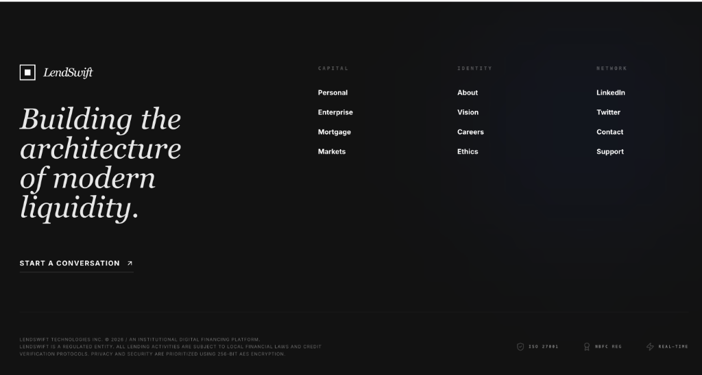

# LendSwift — Institutional-Grade Fintech Onboarding Platform

LendSwift is a production-ready, editorial-style fintech application engineered to redefine the loan application journey. Built for institutional reliability, it combines high-fidelity design with complex financial logic, featuring real-time underwriting, biometric identity verification, and an 8-step cinematic onboarding flow.


## 💎 Design Philosophy: "Editorial Fintech"

LendSwift departs from generic "SaaS dashboards," opting for an **Editorial Fintech** approach. This philosophy prioritizes:
- **Cinematic Experience**: Framer Motion orchestrations that guide the user through a "living" interface.
- **Premium Typography**: Sophisticated serif and sans-serif pairings for a magazine-like readability.
- **Glassmorphism & Depth**: Subtle transparency and layering that creates a sense of institutional security.
- **High-Density Clarity**: Complex financial data structured into intuitive, high-contrast layouts.

---

## 🚀 Core Systems Architecture

### 📋 Multi-Step Wizard Orchestration
LendSwift utilizes a persistent wizard pattern to manage the complex data requirements of institutional lending. This reduces cognitive load by segmenting the application into 8 distinct, logical phases:
1. **Loan Selection**: High-velocity tiering and purpose definition.
2. **Personal Intelligence**: Primary applicant data capture.
3. **Institutional KYC**: Statutory ID verification and Biometric matching.
4. **Address Validation**: Geo-referenced residence mapping.
5. **Employment Analytics**: Dynamic income and professional mapping.
6. **Co-Applicant Integration**: Joint liability management.
7. **Document Dossier**: Secure asset and identity repository.
8. **Final Submission**: Application finalization and tracking.

### 🧠 Decision Architecture

| Decision | Choice | Rationale |
| :--- | :--- | :--- |
| **Form Management** | **React Hook Form** | **Performance & Predictability**. Unlike Formik, RHF utilizes uncontrolled inputs, minimizing re-renders and ensuring the UI remains fluid even with hundreds of form fields. |
| **Validation** | **Zod** | **Type Integrity**. Zod provides a first-class developer experience with React 19, offering seamless TypeScript integration and a more declarative API than Yup for complex financial cross-field validation. |
| **State Management** | **Zustand** | **Lightweight Persistence**. Zustand handles the global application state with zero boilerplate, facilitating instant session recovery via `localStorage` persistence. |

---

## 🛠️ Technical Engineering Stack

- **React 19**: Core UI framework with Concurrent Mode support.
- **Framer Motion**: Physics-based animations and cinematic transitions.
- **Tailwind CSS**: Utility-first styling for high-fidelity custom design systems.
- **Zustand**: Centralized state management with persistence middleware.
- **Lucide React**: Premium institutional iconography.

---

## 🏁 Getting Started

### 📦 Installation
```bash
# Clone the repository
git clone [repository-url]

# Install dependencies
npm install

# Launch high-velocity development server
npm run dev
```

### 🧪 Quality Assurance
Maintain institutional standards with our automated suite:
- **E2E Testing**: `npx cypress run` (Covers 15+ critical user flows)
- **Linting**: `npm run lint`
- **Formatting**: `npm run format`

---

## 📁 Document Dossier & KYC
LendSwift features a state-of-the-art KYC module:
- **Real-time OCR Simulation**: Extracts and validates PAN/Aadhaar formats instantly.
- **Biometric Matching**: AI-driven face matching with confidence scoring.
- **Secure Vaults**: AES-256 encryption simulation for all identity assets.

---

## ⚠️ Known Limitations
- **Backend Integration**: Currently utilizes a high-fidelity simulation layer for underwriting and submission. Production API endpoints require configuration in `useLoanStore`.
- **Browser Compatibility**: Optimized for modern evergreen browsers (Chrome, Safari, Edge). Legacy IE support is not included.
- **Mobile Camera**: Facial verification requires a secure HTTPS context for native camera access in production.

---

<div align="center">
  <p>Engineered with precision for the next generation of global fintech.</p>
  <p><strong>LendSwift | Institutional Fintech Engineering</strong></p>
</div>


